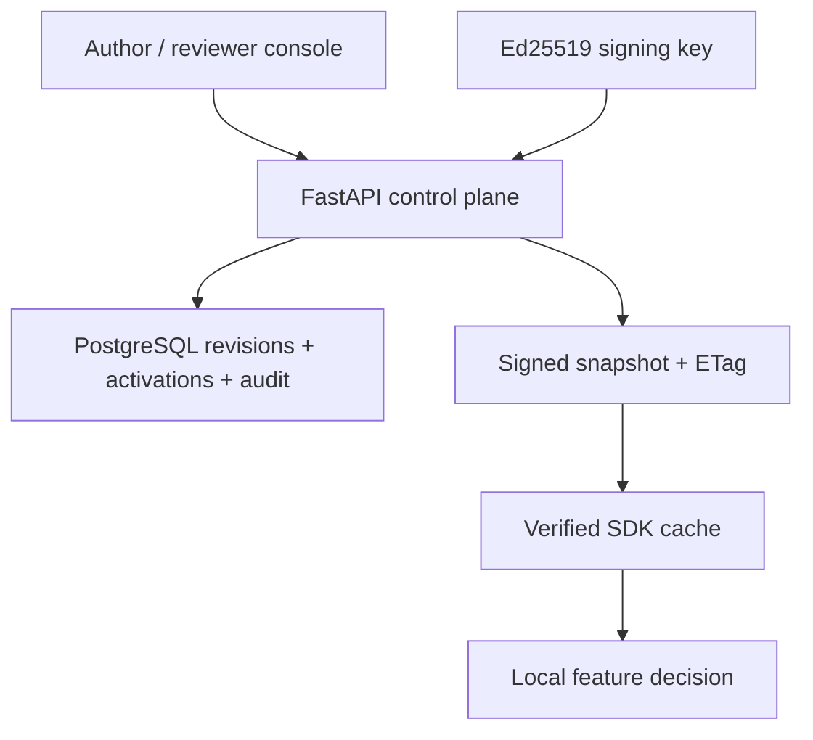
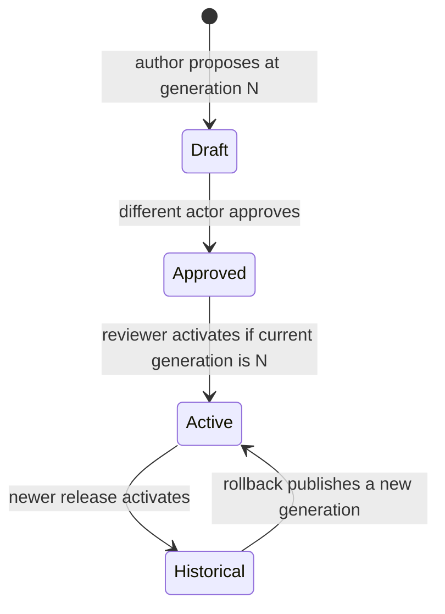

# Signal Loom

**Reviewed feature releases, signed configuration snapshots, and deterministic offline evaluation.**

[](https://github.com/Karthikvk1899/signal-loom/actions/workflows/ci.yml)

A team wants to enable a new checkout for 10% of customers, inspect exactly who would receive it, require a second person to review it, and roll back without deploying application code. Signal Loom implements that control plane and a Python SDK that keeps requests off the network evaluation path.

A release is an immutable bundle of boolean flags. Authors propose a bundle against a generation; a different actor approves it. Reviewers activate with compare-and-set semantics. PostgreSQL atomically records the active pointer, signed snapshot, and audit event. Clients verify Ed25519 signatures and evaluate locally using stable SHA-256 cohorts. When a refresh cannot succeed, the last verified bundle remains usable only until an explicit freshness deadline.

This is a working reference system, **not a production-qualified feature management service**. No deployment, benchmark, high-availability, or security certification is claimed.

## Why this project exists

The related projects solve different problems: [Ledger Bridge](https://github.com/Karthikvk1899/ledger-bridge) reconciles events, [Quota Forge](https://github.com/Karthikvk1899/quota-forge) admits work, [Saga Harbor](https://github.com/Karthikvk1899/saga-harbor) coordinates compensations, and [Relay Foundry](https://github.com/Karthikvk1899/relay-foundry) delivers webhooks. Signal Loom addresses **safe configuration distribution to independently running applications**.

| Area | Implemented engineering |
|---|---|
| Backend | FastAPI, strict request models, scoped credentials, independent approval, generation conflict handling |
| Frontend | React/TypeScript release studio, cohort previews, exact revision inspection, review queue, rollback and audit trail |
| Data | PostgreSQL transactions, row locks, immutable application-level revisions, indexed audit cursor, explicit schema initialization |
| Distributed clients | Signed snapshots, conditional GET, deterministic evaluation, monotonic generations, bounded last-known-good cache |
| Infrastructure | Non-root app containers, loopback host bindings, Compose readiness and migration ordering |
| Operations | Dependency audits, Python and frontend tests, real Docker integration, CodeQL, failure runbooks and threat model |

Kafka and Redis are deliberately unnecessary here. The database is the source of truth; read-only snapshots decouple runtime decisions from control-plane availability. Adding a broker would not strengthen the activation transaction or the SDK's local evaluation guarantee.

## Architecture





## Quick start

Requires Docker Engine with Compose v2, Python 3, and available ports 8080 and 3000. Commands run from the repository root. These commands create fresh local development secrets; never use the Compose database password outside the isolated demo network.

```bash
git clone https://github.com/Karthikvk1899/signal-loom.git
cd signal-loom
python3 scripts/init_env.py
docker compose up -d --build --wait
docker compose exec api python scripts/seed.py
```

The seed prints **AUTHOR_TOKEN**, **REVIEWER_TOKEN**, and **SDK_TOKEN** once and creates a draft for `demo/prod`. Save them locally. Seed is intentionally a one-time demo initializer: rerunning it against the same volume returns a conflict for the existing environment.

Open **http://localhost:3000**:

1. Paste AUTHOR_TOKEN, select Author, and connect. Inspect or modify the draft in the configuration studio. Preview synthetic subject IDs before proposing another revision.
2. Disconnect; paste REVIEWER_TOKEN, select Reviewer, and connect. Inspect the exact immutable bundle, approve, then activate it.
3. Propose a second release at the new generation with a different rollout. Approve and activate it; use the previous revision's rollback action to publish its configuration as another generation.

The view selector is a UI convenience, **not authorization**. The API enforces the credential's actual role. Do not share production reviewer credentials. The console stores tokens only in memory and clears fetched data on disconnect.

API documentation: **http://localhost:8080/docs**. The checked-in [OpenAPI contract](docs/openapi.json) is generated from the application.

## Use the SDK

Install Python 3.12+, then `pip install -r requirements.lock && pip install --no-deps -e .`. Obtain the signing public key from authenticated `GET /v1/key` over a trusted channel and pin it in application configuration. Do not fetch a new trusted key on every refresh.

```python
from loom.sdk import Client

client = Client(
    url="http://localhost:8080",  # HTTPS is required outside the local demo
    token="<SDK_TOKEN>",
    public_key="<PINNED_ED25519_PUBLIC_KEY>",
    environment="demo/prod",
    max_age=60,
)
client.refresh()  # Call periodically from your application's scheduler, e.g. every 10s.
decision = client.evaluate("new_checkout", "synthetic-customer-42", default=False)
print(decision)  # value, reason, generation; rollout decisions include a bucket
```

Evaluation makes no HTTP calls and does not send subject IDs to the control plane. The preview endpoint is a deliberate exception: preview subjects are submitted to the API. Use synthetic identifiers there. Snapshot rules, including allow/deny IDs, are visible to readers; never place secrets or sensitive personal data in bundles.

## Consistency and failure boundaries

| Boundary | Behavior | Limit |
|---|---|---|
| Propose | Bundle immutable after insertion; base generation checked under environment row lock | Repeated creation can produce multiple equivalent drafts; no creation idempotency key |
| Approve | Different actor required; approval repeat is idempotent | Bootstrap administrator provisions actor identities and is trusted |
| Activate | Environment lock + expected generation + approved revision; pointer, snapshot and audit commit together | Ambiguous HTTP failure requires reading current state before retry |
| Rollback | Only a previously activated revision; publishes a higher generation | Clients observe it on refresh, not instantaneously |
| Snapshot | One MVCC read joins current pointer and activation; ETag handles unchanged reads | Reader access is tenant scoped, not environment scoped |
| SDK | Verify signature/scope; reject lower generations or changed contents at same generation; monotonic freshness timer | Cache/high-water mark are in memory and reset on process restart |
| Outage | Failed refresh never renews freshness; expiry returns the caller's default | Revocation cannot retract an already cached bundle before expiry |

An activation conflict is **409**, not permission to retry blindly. A stale draft must be proposed again against current state. Rollback is explicit and cannot activate a never-released stale proposal. Flags use disabled → deny → allow → percentage precedence. Changing salt reshuffles cohorts; increasing rollout with the same salt preserves previously included subjects. Missing flags return false, while an unavailable/stale bundle uses the caller-supplied default. See [contracts](docs/CONTRACTS.md).

## Verification

```bash
python3 -m venv .venv
. .venv/bin/activate
pip install -r requirements.lock
pip install --no-deps -e .
ruff check loom tests scripts
pytest -q -m 'not integration'
pip-audit -r requirements.lock
(cd ui && npm ci && npm test && npm run build && npm audit --audit-level=high)
docker compose --profile test run --rm integration
```

The integration tests use **real HTTP and PostgreSQL**, not a SQLite substitute. They assert independent approval, tenant isolation, credential revocation, single-winner concurrent activation, stale proposals, invalid rollback rejection, signature validation, SDK/preview parity, ETags, and the release/rollback audit trail. CI also stops PostgreSQL, checks readiness failure, restarts it, and reruns integration. CodeQL scans Python and TypeScript. Passing these checks does not establish performance, production network security, database failover, or real identity-provider integration.

See [operations](docs/OPERATIONS.md), [threat model](docs/THREAT_MODEL.md), [design decisions](docs/DECISIONS.md), and [security reporting](SECURITY.md).

Stop with `docker compose down`. **`docker compose --profile test down -v` permanently removes local demo data.** Keep `.env` across normal restarts; replacing its signing key requires a coordinated client trust change.

## Scope and contribution

Boolean flags only; no arbitrary expressions, remote code, user profiling, automatic metric-based rollout, external identity provider, streaming subscription, or browser SDK. Lists are capped at 100 entries and request bodies at 64 KiB. Revisions/activations/audit currently have no retention job. Application-level audit is not tamper-proof against a database administrator. The UI shows latest 100 revisions and first 100 audit events; the API offers audit cursor pagination.

Contributions should include an invariant, a failure case, and a test. Run the checks above before submitting a pull request. Changes to evaluation framing, signing canonicalization, or schema versions require explicit compatibility review. MIT licensed.
